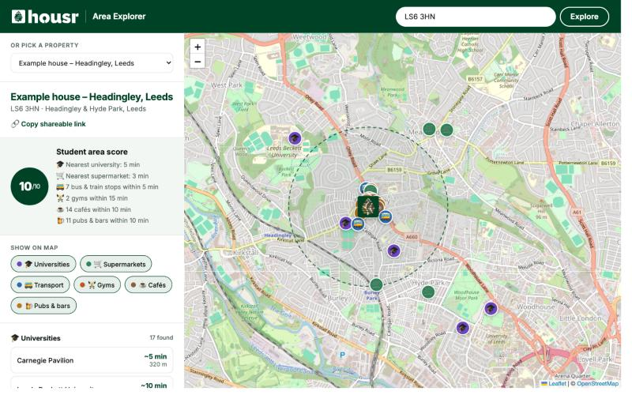

<p align="center">
  
</p>

<h1 align="center">Area Explorer</h1>

<p align="center">
  <strong>See what's within walking distance of a student house: unis, supermarkets, transport, gyms, cafés and pubs.</strong><br>
  <a href="https://patrick0200-hsr.github.io/housr-area-explorer/">👉 Try it live</a>
</p>



## Why

When students pick a house, the first questions are usually *"How far is it from uni?"* and *"Is there a Tesco nearby?"*. Area Explorer answers those in a few seconds. Type a postcode or pick a property to get:

- 🗺️ **An interactive map** with the house and everything nearby
- ⏱️ **Approximate walking times** to the closest places in each category
- ⭐ **A student area score out of 10**, plus quick highlights such as "14 cafés within 10 min"
- 🔗 **A shareable link** (e.g. `?postcode=LS6 3HN`) to send to housemates or a landlord

It works on phones too.

## How it works

It's a plain website with no server, no build step and no API keys.

| Piece | What it does |
| --- | --- |
| [postcodes.io](https://postcodes.io) | Turns a UK postcode into a map location (free, open data) |
| [Overpass API](https://wiki.openstreetmap.org/wiki/Overpass_API) | Finds nearby places in [OpenStreetMap](https://www.openstreetmap.org) |
| [Leaflet](https://leafletjs.com) | Draws the interactive map |
| `data/*.json` | Pre-saved results for the example properties, so they load instantly even when the free map service is busy |
| Browser cache | Remembers postcodes you've searched for a week |

**Walking time** is the straight-line distance plus 30% (streets aren't straight), at about 4.8 km/h. It's a good guide but not exact.

**The area score** gives each category a full point if the nearest one is within a "good" walk, and half a point if it's within double that:

| Category | "Good" walk |
| --- | --- |
| 🎓 University | 20 min |
| 🛒 Supermarket | 10 min |
| 🚌 Bus / train stop | 5 min |
| 🏋️ Gym | 15 min |
| ☕ Café | 10 min |
| 🍺 Pub or bar | 10 min |

## Run it locally

```bash
git clone https://github.com/Patrick0200-HSR/housr-area-explorer.git
cd housr-area-explorer
python3 -m http.server 8000
```

Then open http://localhost:8000.

## Change the example properties

1. Edit `properties.json` to add a name and postcode.
2. Run `python3 scripts/save_example_data.py` to pre-save their nearby-places data.
3. Commit and push. GitHub Pages updates automatically.

## Files

```
index.html                  page layout
style.css                   Housr-branded styling (Housr Green #004225)
app.js                      map, search, scoring logic
properties.json             example properties shown in the dropdown
data/                       pre-saved nearby places for those properties
scripts/save_example_data.py  refreshes data/
assets/                     Housr logos (from the Housr Asset Bank) and screenshot
```

## Ideas for next steps

- Use real walking routes instead of straight lines (e.g. with OpenRouteService)
- Pull real Housr property listings from the Housr API
- Compare two houses side by side
- Add more categories, such as launderettes, GPs and late-night food 🍕

---

<sub>A Housr side project by Patrick, built with Claude Code. This isn't an official Housr product. Map data © OpenStreetMap contributors (ODbL).</sub>
